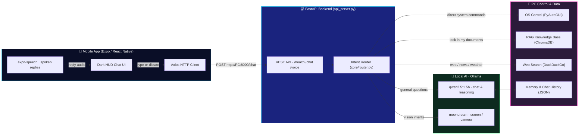

<div align="center">

# 🛰️ JARVIS — Personal AI Assistant

**A voice-powered AI companion that hears you, sees your screen, controls your PC, and lives in your pocket.**


---

JARVIS is a personal AI assistant that runs a **local language model on your own PC** and is controlled from an **Expo / React Native mobile app** on your phone. It is inspired by Tony Stark's JARVIS — a calm, British-accented companion that monitors your system, opens apps, searches the web, answers questions from your knowledge base, and can even look at your screen or webcam.

The project is split into two main parts:

- **Desktop AI engine** (`run_jarvis.py`) — hands-free voice assistant with wake-word detection, speech recognition, text-to-speech, a translucent sci-fi HUD overlay, PC control, memory, and vision.
- **Mobile companion** (`mobile/`) — a dark, glowing HUD-style chat app that talks to the desktop engine over your local network through a **FastAPI** backend (`api_server.py`).

> **Note:** This project is in active development. Features marked as *Implemented* are verified in the source code; anything marked *Planned* or *Experimental* is **not** yet production-ready.

</div>

---

## Table of Contents

- [Overview](#overview)
- [Project Preview](#project-preview)
- [Features](#features)
- [Technology Stack](#technology-stack)
- [System Architecture](#system-architecture)
- [Project Structure](#project-structure)
- [Prerequisites](#prerequisites)
- [Installation and Setup](#installation-and-setup)
- [Running the Project](#running-the-project)
- [API Reference](#api-reference)
- [Configuration](#configuration)
- [Troubleshooting](#troubleshooting)
- [Roadmap](#roadmap)
- [Contributing](#contributing)
- [License](#license)
- [Acknowledgments](#acknowledgments)

---

## Overview

JARVIS combines three layers into one assistant:

1. **A mobile remote control** — a polished dark sci-fi UI (Expo / React Native) where you type or dictate a command, and JARVIS replies in British English with **expo-speech** on your phone speaker.
2. **A local AI brain** — commands are routed through a FastAPI server on your PC. Simple system tasks (open apps, volume, screenshots, YouTube) are handled instantly by Python automation; complex questions are answered by the **Ollama** model `qwen2.5:1.5b` running entirely on your machine — no cloud key required.
3. **A desktop voice assistant** — when you're at your PC, `run_jarvis.py` gives you a fully hands-free experience: wake words, real-time microphone listening with VAD, spoken replies, on-screen HUD, screen/webcam vision, knowledge-base retrieval (RAG), and background reminders.

Everything runs on your own hardware and network. Your data stays local.

---

## Project Preview

> ⚠️ **Screenshots are not available yet.** The repository currently has no preview images committed. Add real screenshots and update the paths below.

**Where to put your images:** create the folder `assets/screenshots/` at the repository root and place your images there, then update the `src` paths below. Keep the images reasonably sized for GitHub (e.g. 800–1200 px wide for desktop shots).

| Desktop HUD overlay | Mobile app chat |
|:-------------------:|:---------------:|
| `assets/screenshots/desktop-hud.png` | `assets/screenshots/mobile-chat.png` |

```
assets/screenshots/
├── desktop-hud.png     ← translucent HUD ring while listening/speaking
├── mobile-chat.png     ← JARVIS LIVE ENGINE chat screen
└── mobile-live-mode.png ← LIVE LINK voice mode active
```

Suggested screenshots to capture:

- The desktop **HUD overlay** while JARVIS is listening (green ring) and speaking (pink ring).
- The mobile app **chat screen** showing a user command and JARVIS's reply.
- The mobile app in **LIVE LINK mode**.
- The FastAPI **Swagger UI** (`http://localhost:8000/docs`).

---

## Features

### ✅ Implemented — Desktop Engine (`run_jarvis.py`)

| Feature | Description |
| --- | --- |
| **Wake-word activation** | Listens for "JARVIS" (and `jarvice`, `javis`, `javi`, `hello`, `hi`) to activate a hands-free conversation session. |
| **Voice activity detection (VAD)** | Energy-based VAD (16 kHz, adaptive silence detection) with an 18-second conversation timeout while active. |
| **Speech-to-text** | Google Speech Recognition first, with an automatic **faster-whisper** (`tiny.en`) local fallback. |
| **Text-to-speech** | **edge-tts** British voice (`en-GB-RyanNeural`) with a **Piper** offline fallback model (`en_GB-northern_english_male-medium`). |
| **Sci-Fi HUD overlay** | Translucent frameless PyQt6 ring that changes color by state: idle (blue), listening (green), thinking (amber), speaking (pink). |
| **System control** | Open apps (camera, calculator, notepad, settings, task manager, explorer, Chrome, YouTube…), kill processes. |
| **OS automation** | Volume up/down/mute, lock PC, system diagnostics (CPU / RAM / battery), screenshots saved to `Screenshots/`. |
| **Browser control** | Open Google searches, navigate back/forward, scroll, refresh, open/close tabs, click the first search result, and click screen elements via an on-screen finder. |
| **YouTube playback** | Plays a requested video through `pywhatkit`. |
| **Memory** | Stores key-value facts ("remember that …") and persists the last 10–12 chat turns to `data/chat_history.json`. |
| **Reminders / scheduler** | Background thread that speaks reminders ("remind me in X minutes"). |
| **Web search + AI answer** | Searches the web (DuckDuckGo) and feeds results into the local LLM to answer questions. |
| **Clipboard AI** | Transforms clipboard content with the LLM ("fix my clipboard", "translate clipboard"). |

### ✅ Implemented — Mobile App (`mobile/`) + Backend API (`api_server.py`)

| Feature | Description |
| --- | --- |
| **Dark HUD chat UI** | Cyan-on-navy sci-fi interface with an animated pulsing arc ring. |
| **Text chat with PC** | Sends your message via **Axios** to the FastAPI backend at `http://<YOUR_PC_IP>:8000/chat`. |
| **Spoken replies** | JARVIS's reply is read aloud on the phone speaker with **expo-speech** in a British English voice (`en-GB`). |
| **LIVE LINK voice mode** | Toggle a hands-free mode; use your phone keyboard's built-in 🎤 dictation to speak commands that get sent as text. |
| **REST API** | `GET /health`, `POST /chat`, `POST /voice` (multipart audio upload for transcription) — see [API Reference](#api-reference). |

### ⚠️ Experimental / Requires Extra Dependencies

These features exist in the source code but **depend on packages that are not listed in `requirements.txt` yet**. They may not work until you install the extra dependencies shown in the [setup guide](#optional-feature-dependencies).

| Feature | Description | Missing dependency |
| --- | --- | --- |
| **Screen & camera vision** | Captures the screen or webcam and asks the Ollama **moondream** vision model to describe it. | `mss`, `opencv-python` |
| **RAG knowledge base** | Indexes `.txt`, `.md`, `.pdf`, `.docx` files in `KnowledgeBase/` into a ChromaDB vector store and retrieves relevant context for answers. | `chromadb`, `sentence-transformers`, `pypdf`, `python-docx` |
| **Web search** | DuckDuckGo search for live web results. | `duckduckgo-search` (or `ddgs`) |

### 🧪 Planned (not implemented yet)

See the [Roadmap](#roadmap) for ideas that are *planned* but not yet built.

---

## Technology Stack

| Layer | Technology | Purpose | Version (from repo) |
| --- | --- | --- | --- |
| **Backend** | Python | Core language | 3.10+ (recommended) |
| **Backend** | FastAPI + Uvicorn | REST API server for the mobile app | not pinned in `requirements.txt` — install separately (see [setup](#installation-and-setup)) |
| **Backend** | Ollama (Python client) | Local LLM runtime | `ollama==0.6.2` |
| **AI / LLM** | `qwen2.5:1.5b` | Default local chat model | defined in `core/config.py` |
| **AI / LLM** | `moondream` | Local vision model (screen / webcam) | defined in `core/config.py` |
| **AI / LLM** | `all-MiniLM-L6-v2` | Sentence embeddings for RAG | defined in `core/config.py` |
| **Speech** | SpeechRecognition + faster-whisper | Speech-to-text (cloud → local fallback) | `SpeechRecognition==3.17.0`, `faster-whisper==1.2.1` |
| **Speech** | edge-tts + Piper | Text-to-speech (cloud → local fallback) | `edge-tts==7.2.8`; Piper model in `piper_models/` |
| **Mobile** | Expo / React Native | Cross-platform mobile app | `expo ^44.0.6`, `react-native ^0.88.0` (per `mobile/package.json`) |
| **Mobile** | Axios | HTTP client to the PC backend | `axios ^1.7.9` |
| **Mobile** | expo-speech | On-device spoken replies | `expo-speech ~58.0.0` |
| **Automation** | PyAutoGUI, pywhatkit, psutil | OS control, YouTube, system stats | `PyAutoGUI==0.9.54`, `pywhatkit==5.4`, `psutil==7.2.2` |
| **Knowledge** | ChromaDB + sentence-transformers | Vector store for RAG | *extra install required* |

> **Dependency note:** `requirements.txt` currently covers the core AI + desktop engine. Some modules import packages (`fastapi`, `uvicorn`, `python-multipart`, `chromadb`, `mss`, `opencv-python`, `PyQt6`, `pypdf`, `python-docx`, `duckduckgo-search`) that are **not** pinned in `requirements.txt` yet. The setup steps below show you exactly what to add.

---

## System Architecture



**How it communicates:**

1. You tap the **LIVE LINK** circle or type a message in the mobile app.
2. The app sends your text to `POST http://<YOUR_PC_IP>:8000/chat` via **Axios**.
3. The FastAPI backend runs the intent router:
   - **Direct system commands** (open app, volume, screenshot, lock PC…) go straight to OS automation.
   - **Everything else** goes to the local Ollama model (`qwen2.5:1.5b`) for an LLM-generated reply.
4. The reply is returned as JSON, and the mobile app reads it aloud with **expo-speech**.
5. The desktop engine (`run_jarvis.py`) follows the same routing locally but with microphone input, wake words, a HUD overlay, and voice output on the PC.

---

## Project Structure

```
JARVIS/
├── api_server.py            # FastAPI backend — REST API for the mobile app
├── run_jarvis.py            # Desktop voice assistant (main entry point)
├── requirements.txt         # Python dependencies (core engine)
├── .gitignore
│
├── mobile/                  # Expo / React Native mobile app (jarvis-mobile-app)
│   ├── App.js               # Main screen: HUD UI, chat, LIVE LINK mode
│   ├── app.json             # Expo config (name, android package, dark theme)
│   ├── index.js             # App entry point
│   ├── package.json         # JS dependencies (axios, expo, expo-speech)
│   ├── eas.json             # EAS build config
│   └── assets/              # App icons & splash
│
├── core/                    # Shared backend brain
│   ├── brain.py             # Ollama chat wrapper (qwen2.5:1.5b), system prompt
│   ├── config.py            # Paths, models, wake words, defaults
│   ├── memory.py            # Persistent memories + chat history (JSON)
│   └── router.py            # Intent classification (vision/RAG/search/…)
│
├── engines/                 # Speech & vision engines
│   ├── stt_engine.py        # Speech-to-text (Google → faster-whisper fallback)
│   ├── tts_engine.py        # Text-to-speech (edge-tts → Piper fallback)
│   ├── vad_engine.py        # Voice activity detection (microphone)
│   └── vision_engine.py     # Screen/webcam capture + moondream analysis
│
├── modules/                 # Capability modules
│   ├── os_control.py        # Open/kill apps, volume, screenshots, browser, click
│   ├── rag_engine.py        # ChromaDB knowledge base over KnowledgeBase/
│   ├── scheduler.py         # Background reminders (spoken)
│   ├── file_manager.py      # Organize folders by file type, find large files
│   ├── web_search.py        # DuckDuckGo web search
│   └── clipboard_ai.py      # Transform clipboard content via the LLM
│
├── ui/
│   └── hud_overlay.py       # PyQt6 translucent sci-fi HUD ring
│
├── data/                    # Runtime data (gitignored except history)
│   ├── config.json          # Assistant config (empty = defaults)
│   ├── memory.json          # Stored memories
│   ├── chat_history.json    # Persistent conversation history
│   └── vector_db/           # ChromaDB vector files (RAG)
│
├── KnowledgeBase/           # 📄 Drop documents here for RAG queries
├── assets/                  # Wake / success / process / error sounds
├── piper_models/            # Offline Piper TTS voice (.onnx)
├── Screenshots/             # Runtime screenshots (gitignored)
└── logs/
```

---

## Prerequisites

| Requirement | Version / Notes |
| --- | --- |
| **Python** | 3.10 or newer recommended (developed on Windows, should work cross-platform with minor tweaks) |
| **Node.js + npm** | Required for the Expo mobile app (Node 18+ recommended) |
| **Expo Go app** | Install on your phone from the App Store / Play Store to test the mobile app |
| **Ollama** | Installed and running — download from <https://ollama.com> |
| **Local models** | `qwen2.5:1.5b` (required for chat), `moondream` (required for vision) |
| **PC & phone on the same network** | Both devices must be able to reach each other over Wi-Fi / LAN |

### Setting up Ollama

1. Install Ollama from <https://ollama.com> and make sure the service is running (the Ollama app stays in your system tray).
2. Pull the required models:

   ```bash
   # Chat / reasoning model (required)
   ollama pull qwen2.5:1.5b

   # Vision model (required only for screen/webcam features)
   ollama pull moondream
   ```

3. Verify with `ollama list` — you should see both models listed.

---

## Installation and Setup

### 1. Backend (Python)

Open a terminal in the project root and create a virtual environment:

```bash
# Windows
python -m venv venv
venv\Scripts\activate

# macOS / Linux
python3 -m venv venv
source venv/bin/activate
```

Install the core dependencies:

```bash
pip install -r requirements.txt
```

> ⚠️ **Important:** `requirements.txt` does **not** currently include the FastAPI server stack. Install it for the mobile API (required to run `api_server.py`):

```bash
pip install fastapi "uvicorn[standard]" python-multipart
```

#### Optional feature dependencies

Install these **only** if you want the experimental modules (vision, RAG, web search, HUD):

```bash
# Screen & webcam vision (engines/vision_engine.py)
pip install mss opencv-python

# RAG knowledge base (modules/rag_engine.py)
pip install chromadb sentence-transformers pypdf python-docx

# Web search (modules/web_search.py)
pip install duckduckgo-search

# Sci-Fi HUD overlay (ui/hud_overlay.py) — requires PyQt6
pip install PyQt6
```

### 2. Mobile app (Expo)

```bash
cd mobile
npm install
```

If any Expo packages have version conflicts, run the Expo doctor:

```bash
npx expo-doctor
npx expo install --fix
```

### 3. Configure the connection

The mobile app needs to know your **PC's local IP address**. Open `mobile/App.js` and replace the `PC_IP` constant:

```js
// mobile/App.js
const PC_IP = "<YOUR_PC_IP>";   // e.g. "192.168.1.50" — NOT "localhost"!
```

> ❗ **Never use `localhost` here.** See [Running the Project](#running-the-project) for the reason, and [Troubleshooting](#troubleshooting) if you can't connect.

---

## Running the Project

Start the services **in this order**:

### Step 1 — Start Ollama

Make sure the Ollama app is running (system tray icon). No terminal command is needed, but you can confirm with:

```bash
ollama list
```

### Step 2 — Start the backend API (mobile companion)

With the virtual environment activated, from the project root:

```bash
python api_server.py
```

You should see Uvicorn listening on `0.0.0.0:8000`. Verify the server locally:

```bash
curl http://localhost:8000/health
```

Expected output:

```json
{"status": "online", "message": "JARVIS API Server running smoothly."}
```

### Step 3 — (Optional) Start the desktop voice assistant

In a **second terminal** (same virtual environment):

```bash
python run_jarvis.py
```

This launches the desktop engine: it will warm up the LLM, start the background scheduler and the HUD overlay, then begin listening for wake words.

### Step 4 — Start the mobile app

In a **third terminal**:

```bash
cd mobile
npx expo start
```

Scan the QR code with the **Expo Go** app on your phone (Android: scan from the Expo Go app; iOS: scan from the Camera app). Make sure the phone and PC are on the **same Wi-Fi network**.

### Connecting your phone to the backend — important!

- `localhost` on your phone refers to **the phone itself**, not your computer. Always use your PC's **LAN IP address** in `mobile/App.js` (the `PC_IP` constant).
- To find your PC's LAN IP:
  - **Windows:** `ipconfig` → look for the `IPv4 Address` (e.g. `192.168.1.50`) under your active Wi-Fi adapter.
  - **macOS / Linux:** `ipconfig getifaddr en0` (macOS) or `hostname -I` (Linux).
- Test from the phone's browser: open `http://<YOUR_PC_IP>:8000/health` — you should see the JSON `{"status": "online", ...}`.
- If that fails, see [Troubleshooting](#troubleshooting) (firewall, network isolation, etc.).

---

## API Reference

The FastAPI backend (`api_server.py`) exposes three endpoints. The interactive **Swagger UI** is available at:

```
http://localhost:8000/docs
```

(ReDoc alternative: `http://localhost:8000/redoc`)

### `GET /health`

Health check — confirms the API server is running.

**Response `200`**

```json
{
  "status": "online",
  "message": "JARVIS API Server running smoothly."
}
```

### `POST /chat`

Process a text command and return JARVIS's reply. The message is routed through the intent classifier — system commands are executed directly, everything else goes to the local LLM.

**Request body**

```json
{
  "message": "open notepad"
}
```

**Response `200`**

```json
{
  "reply": "Notepad opened."
}
```

More examples:

| `message` | Possible reply |
| --- | --- |
| `"What is the CPU and RAM usage?"` | `"CPU 12%, RAM 47%, Battery 86%."` |
| `"Play some lofi on YouTube"` | `"Playing some lofi on YouTube."` |
| `"Take a screenshot"` | `"Screenshot saved."` |
| `"What can you do?"` | An LLM-generated answer via `qwen2.5:1.5b`. |

### `POST /voice`

Uploads an audio recording; the server transcribes it (SpeechRecognition / faster-whisper), processes the resulting text, and returns both the transcription and the reply.

**Request:** `multipart/form-data` with field `file` containing the audio (`.m4a` / `.wav` etc.).

**Response `200`**

```json
{
  "user_text": "what time is it",
  "reply": "The time is 07:19 PM, Sir."
}
```

> **Note:** The mobile app currently sends **text** commands to `/chat` and uses the phone's own dictation + expo-speech for voice input/output. The `/voice` endpoint is available for clients that want to upload audio directly.

---

## Configuration

### `data/config.json`

If this file is empty or missing, JARVIS uses these defaults (defined in `core/config.py`):

| Key | Default | Description |
| --- | --- | --- |
| `assistant_name` | `"JARVIS"` | How the assistant introduces itself |
| `user_title` | `"Sir"` | How JARVIS addresses you |
| `wake_words` | `["jarvis", "jarvice", "javis", "javi", "hello", "hi"]` | Phrases that activate the desktop assistant |
| `voice_rate` | `"+10%"` | Speech rate for edge-tts voice output |
| `offline_mode` | `false` | Reserved for a future fully-offline mode |

Example:

```json
{
  "assistant_name": "JARVIS",
  "user_title": "Sir",
  "wake_words": ["jarvis", "jarvice", "javis", "javi", "hello", "hi"],
  "voice_rate": "+10%",
  "offline_mode": false
}
```

> ⚠️ `data/config.json` and `data/memory.json` are **gitignored** (they may contain private data). Do not commit them.

### Model configuration

The local model names are hardcoded in `core/config.py`:

```python
LOCAL_MODEL = "qwen2.5:1.5b"     # chat / reasoning
VISION_MODEL = "moondream"        # screen & webcam vision
EMBEDDING_MODEL = "all-MiniLM-L6-v2"  # RAG embeddings
```

### Mobile connection

The PC address is currently a hardcoded constant in `mobile/App.js`:

```js
const PC_IP = "<YOUR_PC_IP>";
```

### Recommended (not implemented yet)

For a cleaner setup, the following would be ideal future improvements (open a PR!):

- Move `PC_IP` into a `.env` file (`EXPO_PUBLIC_API_URL=http://<YOUR_PC_IP>:8000`).
- Move `LOCAL_MODEL` / `VISION_MODEL` / `EMBEDDING_MODEL` into `data/config.json`.
- Move the fixed backend port (`8000`) and DB/asset paths into environment variables.

---

## Troubleshooting

### 1. The mobile app can't connect to the backend

- **Test the API from the PC:** `curl http://localhost:8000/health` — if this fails, the server isn't running or crashed. Check the terminal running `python api_server.py`.
- **Test from the phone:** open `http://<YOUR_PC_IP>:8000/health` in the phone's browser. If it won't load, the phone can't reach the PC.
- **Never use `localhost`** in `mobile/App.js` — on the phone, `localhost` is the phone itself.

### 2. Wrong computer IP address

- Find the correct local IP with `ipconfig` (Windows) / `ipconfig getifaddr en0` (macOS) / `hostname -I` (Linux).
- Make sure you're on the **same Wi-Fi network** for both devices, and that the IP in `mobile/App.js` matches exactly (no trailing spaces).

### 3. Port 8000 already in use

Check what's on port 8000 and free it:

```bash
# Windows
netstat -ano | findstr :8000
taskkill /PID <PID> /F

# macOS / Linux
lsof -i :8000
kill -9 <PID>
```

Or change the port in `api_server.py` (`uvicorn.run(app, host="0.0.0.0", port=8000)`) and update the URL in the mobile app.

### 4. Windows Firewall blocking the connection

Windows may block inbound connections on port 8000. Either:

- Allow Python through Windows Defender Firewall when prompted, or
- Add a rule: **Windows Defender Firewall → Advanced settings → Inbound Rules → New Rule → Port → TCP `8000` → Allow** (scope it to your private network).
- Some routers have **client isolation / AP isolation** that blocks device-to-device traffic. If the phone can't reach the PC even with the firewall open, check your router settings.

### 5. Ollama service unavailable

- If you see `LLM Connection Offline` when starting `run_jarvis.py`, open the Ollama app (system tray) and make sure it's running.
- Verify with `ollama list`. If no models are listed, pull them (see [Prerequisites](#prerequisites)).

### 6. Required Ollama model missing

If JARVIS's replies are generic errors ("my local brain encountered an error"), the `qwen2.5:1.5b` model is probably missing:

```bash
ollama pull qwen2.5:1.5b
```

For vision features, also:

```bash
ollama pull moondream
```

### 7. Expo / npm dependency problems

- Run the Expo doctor:

  ```bash
  cd mobile
  npx expo-doctor
  npx expo install --fix
  ```

- `mobile/package.json` currently pins `expo ^44.0.6` alongside `expo-speech ~58.0.0`, which is a **version mismatch** (expo-speech ~58 pairs with a much newer Expo SDK). If you hit native-module errors, run `npx expo install expo-speech` to let Expo resolve a compatible version, or upgrade the whole project with the Expo CLI.
- Delete `node_modules` and reinstall if things look corrupted:

  ```bash
  cd mobile
  rm -rf node_modules package-lock.json   # or rmdir /s /q node_modules on Windows
  npm install
  ```

### 8. Optional modules fail with ImportError

The experimental modules (vision, RAG, web search, HUD) import packages that aren't in `requirements.txt`. Install them with the commands under [Optional feature dependencies](#optional-feature-dependencies).

---

## Roadmap

> These are **planned ideas**, not implemented features. None of the items below exist in the source code yet.

- [ ] **Docker / docker-compose** setup for one-command backend + Ollama + vector DB.
- [ ] **Voice upload from mobile** — wire the mobile app to the existing `POST /voice` endpoint so speech is transcribed on the PC instead of using the phone keyboard mic.
- [ ] **WebSocket / streaming replies** for lower-latency chat.
- [ ] **Environment-variable configuration** (`EXPO_PUBLIC_API_URL`, `JARVIS_PORT`, etc.).
- [ ] **Knowledge-base ingestion UI** — add documents from the mobile app or a CLI command.
- [ ] **Multi-language wake words** and responses.
- [ ] **GitHub Actions CI** — lint, type-check, and test on every PR.
- [ ] **Native Android / iOS builds** with EAS for standalone installs (config already scaffolded in `mobile/eas.json`).
- [ ] **Automatic model bootstrapping** — pull missing Ollama models on first run.

---

## Contributing

Contributions are welcome — this is an early-stage project and every improvement helps. To contribute:

1. **Fork** the repository.
2. **Create a feature branch:** `git checkout -b feat/my-feature`
3. **Make your changes** — keep them focused, and follow the existing code style (concise functions, British English replies, no secrets in code).
4. **Test** what you can: run the backend (`python api_server.py`), the desktop engine (`python run_jarvis.py`), and the mobile app (`npx expo start`).
5. **Commit** with a clear message: `git commit -m "feat: add X"`
6. **Push** and open a **Pull Request** describing what you changed and why.

Small, well-scoped PRs are much easier to review than large rewrites. If you're unsure, open an issue first to discuss the idea.

---

## License

**No license has been chosen for this project yet.**

The repository does **not** currently contain a root `LICENSE` file. Note that `mobile/LICENSE` is the MIT license bundled with the Expo project template (© 650 Industries, Inc.) and only covers that template's files — it does **not** license this project's code.

Before publishing publicly, please choose an appropriate license (e.g. MIT, Apache-2.0, GPL-3.0) and add a `LICENSE` file at the repository root. Until a license is selected, all rights are reserved by default.

---

## Acknowledgments

JARVIS is built on the shoulders of these excellent open-source projects:

- **Ollama** — effortless local LLM runtime · <https://ollama.com>
- **Qwen2.5** — the local reasoning model powering the brain
- **Moondream** — the compact local vision model
- **FastAPI** + **Uvicorn** — the mobile API layer
- **Expo** & **React Native** — the cross-platform mobile experience
- **Axios** — reliable HTTP communication
- **edge-tts** & **Piper** — natural British English text-to-speech
- **faster-whisper** & **SpeechRecognition** — speech-to-text
- **PyAutoGUI**, **pywhatkit**, **psutil** — desktop automation superpowers
- **ChromaDB** & **sentence-transformers** — local knowledge retrieval (RAG)
- **DuckDuckGo** — privacy-friendly web search
- **PyQt6** — the translucent HUD overlay
- **pygame** — instant sound playback for UI effects

And, of course, **J.A.R.V.I.S.** from Marvel — the inspiration for making a personal assistant feel like science fiction.

---

<div align="center">

**Made with ⚡ and a lot of local AI.**  
Star the repo ⭐ if JARVIS made your day a little more sci-fi.

</div>